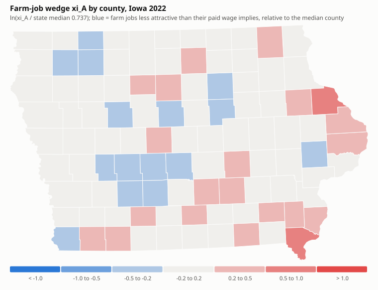

# Iowa 2022 calibration report (milestone M3)

Generated by `python -m urqse.calibrate.run_state IA 2022` from `data/IA/2022/` (M2 build, `reports/IA_2022_REPORT.md`) and LODES8 OD 2022. 99 counties plus the external zone. Wage unit: state mean non-farm earnings per BEA non-farm job = 62,624 $.

## Estimates

| Parameter | Estimate | Default | Note |
|---|---|---|---|
| kappa*lam (per minute) | **0.0208** (cluster-origin SE 0.0007; robust 0.0004; plain Poisson 0.00003) | 0.08 | PPML, in-state county pairs, own-county flows excluded |
| kappa*lam with own-county flows | 0.0357 (cluster SE 0.0011) | | own time is the M2 area proxy |
| theta_T, state | **0.456** | 0.40 | rent bill / (farm earnings + rent paid to non-operator landlords) |
| theta_T, county median (IQR) | 0.504 (0.407 to 0.568) | | same definition |
| over-ID corr(model rho, NASS rent) | 0.499 (logs 0.596) | | 97 published counties |
| over-ID level ratio model/NASS | 0.806 at theta_T = 0.40; 1.014 at 0.456 | | farmland-weighted |

The Iowa parameter set is `urqse.calibrate.run_state.state_params('IA', 2022)`: `Params()` with kappa_lam and theta_T replaced by the values in `src/urqse/calibrate/estimates/IA_2022.json`. The global defaults in `params.py`, and so the web app's synthetic scenario, are unchanged.

## 1. Inversion fit (spec §5)

| Parameter set | wage contraction | baseline solve | max rel. error HU / HA / wA / N |
|---|---|---|---|
| default `Params()` | converged=True, 68 it, residual 9.5e-14 | converged=True, residual 2.3e-13 | 5.8e-13 / 5.7e-13 / 2.2e-16 / 8.9e-16 |
| Iowa estimates | converged=True, 14 it, residual 4.1e-14 | converged=True, residual 1.2e-13 | 2.6e-13 / 2.6e-13 / 2.2e-16 / 8.9e-16 |

The inversion is exact on real data: the calibrated fundamentals regenerate jobs, farm wages and residents to better than 1e-12 (bar 1e-7). Flow offsets: converged=True, residual 8.7e-12.

## 2. Farm-job wedge xi_A

xi_A = (effective farm wage) / (observed farm earnings per job), both in units of mean non-farm earnings (spec §5 step 2). Its level is pinned by the normalisation that the job-weighted mean non-farm wage equals 1, so read it relative to the non-farm wedge of 1.

| Group | counties | median xi_A | min | max |
|---|---|---|---|---|
| core | 1 | 0.576 | 0.576 | 0.576 |
| suburb | 21 | 0.382 | 0.216 | 1.185 |
| rural | 77 | 0.318 | 0.154 | 2.929 |
| all | 99 | 0.343 | 0.154 | 2.929 |

corr(ln xi_A, ln observed farm earnings per job) = -0.996. With default kappa*lam = 0.08 the median is 0.346; xi_A depends on kappa*lam through the effective wages, not on theta_T. The correlation says the wedge is almost entirely the inverse of measured farm earnings: the effective farm wage that reproduces farm job counts varies little across counties, so where BEA earnings per job are high the wedge is low. The per-county values are in the county table at the end.

## 3. Cash-rent over-identification test (spec §5 step 5)

Model rent rho_j = (theta_T/theta_H) w_Aj H_Aj / T^F_j is in wage units per hectare. In dollars per acre: rho x 62,624 $ x 0.40469 ha/acre. NASS: 2022 county cash rent, non-irrigated cropland. T^F: CDL cropland. The 2 counties whose rent NASS did not publish (filled in M2 with the 'other counties' value) are left out of the statistics.

| | theta_T = 0.40 | theta_T estimated |
|---|---|---|
| correlation (levels) | 0.499 | 0.499 |
| correlation (logs) | 0.596 | 0.596 |
| OLS slope NASS on model | 0.216 | 0.171 |
| OLS intercept, $/acre | 203.0 | 203.0 |
| log-log slope | 0.227 | 0.227 |
| level ratio model/NASS (farmland-weighted) | 0.806 | 1.014 |
| median county ratio model/NASS | 0.717 | 0.903 |
| s.d. of ln(model/NASS) | 0.310 | 0.310 |

NASS rents span 154 to 304 $/acre; model rents at theta_T = 0.40 span 46 to 440 $/acre. Correlation and log slope do not depend on theta_T (it scales every county's rent by the same factor).

**Level.** At 0.40 the model rent is 0.81 of NASS. Part of the gap is the M2 job scaling: H_A is BEA farm jobs scaled to ACS workers (factor 0.55 to 0.91), while w_A,obs is earnings per BEA job, so the model farm wage bill w_A H_A is that factor times BEA farm earnings. Without the scaling the ratio is 1.11.

**Pattern.** The model rent varies far more across counties than NASS rents do (log-log slope 0.23; a perfect fit is 1). Model rent is proportional to farm earnings per hectare, and 2022 farm earnings per job range from 11,462 $ to 219,654 $, while cash rents are contracts set on expected land productivity. The largest deviations from the median ratio:

| County | kind | NASS $/acre | model $/acre (0.40) | model/NASS | farm earnings $ per BEA job |
|---|---|---|---|---|---|
| Lucas | rural | 169 | 46 | 0.27 | 11,462 |
| Washington | suburb | 237 | 432 | 1.82 | 165,792 |
| Allamakee | rural | 238 | 368 | 1.55 | 84,707 |
| Sioux | rural | 295 | 440 | 1.49 | 177,705 |
| Fremont | rural | 237 | 88 | 0.37 | 101,731 |
| Dubuque | suburb | 274 | 371 | 1.35 | 91,046 |
| Hardin | rural | 256 | 333 | 1.30 | 177,511 |
| Delaware | rural | 270 | 348 | 1.29 | 119,778 |

Low ratios come from low farm earnings per job (Lucas) or few farm jobs per hectare (Fremont); high ratios from high farm earnings per hectare of cropland. That fits livestock-heavy counties, whose earnings are not returns to cropland (inferred; not checked against livestock data). The test passes in sign and rough level and fails in dispersion.

## 4. theta_T from rent shares

From (F), rho T^F = (theta_T/theta_H) x (farm labour bill), so theta_T = rent bill / (rent bill + labour bill). Rent bill = NASS cash rent x CDL cropland. The choice is the labour bill, because BEA farm earnings (wages + proprietors' income) include owner-operators' returns to their own land and capital (M2 caveat).

| Labour bill | state theta_T | county median | p10 | p90 | min | max |
|---|---|---|---|---|---|---|
| model wage bill wA_obs x HA (spec §5 literal) | 0.453 | 0.482 | 0.370 | 0.555 | 0.268 | 0.772 |
| BEA farm earnings as labour | 0.374 | 0.402 | 0.297 | 0.478 | 0.210 | 0.674 |
| BEA farm earnings net of owner-operators' land rent (chosen) | 0.456 | 0.504 | 0.357 | 0.643 | 0.239 | 1.322 |
| same, 5-year mean farm earnings | 0.699 | 0.779 | 0.533 | 1.010 | 0.353 | 1.870 |

**Choice:** labour bill = BEA farm earnings minus the owner-operated share of land rent, omega x rho x T^F (spec §12.1: operator income = w_A + omega rho T^F / H_A, so earnings net of owned-land rent is the labour part). Equivalently theta_T = rho T^F / (E + (1 - omega) rho T^F): value added net of K, X is farm earnings plus the rent paid out to non-operator landlords. It is in dollars, so the M2 job scaling does not enter. State estimate **0.456** vs the 0.40 default. Returns to owner-operators' own capital are still in E, so this is a lower bound on the land share of (land + labour) in that respect; livestock income unrelated to cropland pushes the same way in livestock counties.

The 5-year mean row uses CAINC45 farm earnings 2018 to 2022 (nominal, BEA 2023-11 release) against 2022 rents. 2022 was a high-income year, so the multi-year mean lowers earnings and raises theta_T. 2 counties have theta_T > 1 under the chosen definition in 2022 alone (owner-operated land rent exceeds farm earnings): Appanoose, Lucas, the two lowest farm-earnings counties.

## 5. kappa*lam by PPML on LODES

LODES8 OD 2022, JT00 (all jobs), S000, block pairs summed to residence-county x workplace-county. Files: `ia_od_main`, `ia_od_aux` (out-of-state residents working in IA) and the aux files of IL, MN, MO, NE, SD, WI (IA residents working there). Out-of-state blocks count only if they lie in the 39 counties of the M2 external zone, whose travel time is the time to the nearest of them; other out-of-state blocks are dropped. Total flows used: 1,557,911; in-state 1,425,021, own-county share 0.580; external zone row 67,084, column 71,141. Travel time: `travel.npz` (OSRM car minutes, own-county = M2 area proxy).

ln E[flow_ij] = FE_i + FE_j - kappa*lam t_ij, by Poisson pseudo-ML (Newton, numpy; `urqse.calibrate.gravity`). SEs: plain = inverse Poisson information (assumes Var = mean; far too small under overdispersion), robust = Eicker-White HC0, cluster = sandwich clustered by origin county.

| Sample | kappa*lam | SE cluster | SE robust | SE plain | pairs | zeros | pseudo-R2 | converged (residual) |
|---|---|---|---|---|---|---|---|---|
| in-state, off-diagonal (headline) | 0.0208 | 0.0007 | 0.0004 | 0.00003 | 9702 | 1145 | 0.935 | True (3e-13) |
| in-state, own-county flows included | 0.0357 | 0.0011 | 0.0011 | 0.00003 | 9801 | 1145 | 0.945 | True (1e-10) |
| in-state, off-diagonal, t <= 90 min | 0.0522 | 0.0008 | 0.0008 | 0.00014 | 1001 | 3 | 0.992 | True (1e-15) |
| in-state, off-diagonal, t <= 60 min | 0.0537 | 0.0023 | 0.0021 | 0.00036 | 372 | 0 | 0.996 | True (2e-11) |
| with external zone, off-diagonal | 0.0221 | 0.0008 | 0.0005 | 0.00003 | 9900 | 1145 | 0.901 | True (7e-12) |
| with external zone, own-county included | 0.0357 | 0.0011 | 0.0011 | 0.00003 | 9999 | 1145 | 0.943 | True (2e-15) |

The headline 0.0208 per minute is about 26% of the 0.08 default. The exponential-in-minutes form does not fit all trip lengths with one slope: restricted to pairs within 90 minutes it is 0.0522, within 60 minutes 0.0537, close to the default. Long pairs (median in-state off-diagonal time 203 min) carry more flow than a steep exponential allows (weekly commuters, multi-site employers, LODES assigning jobs to a firm's reporting address are candidate reasons, not tested). Including own-county flows gives 0.0357: the 58% of workers who stay in their county pin the slope at the short end through the area-based own-time proxy, so that number is partly a property of the proxy. The headline is the spec's specification on all off-diagonal pairs; the model uses one kappa*lam for every pair including own, so this choice matters for counterfactuals. `# VERIFY`.

## 6. Saved outputs

- `data/IA/2022/calibrated.npz` (git-ignored): fips, every `Fundamentals` field, the baseline N, wU, wA, r, rho, the Params used (JSON), and $ per wage unit. Calibrated with the Iowa estimates.
- `src/urqse/calibrate/estimates/IA_2022.json` (tracked): kappa_lam and theta_T with sources.
- `tests/snapshots/IA_2022.json` (tracked): pinned summary numbers; `tests/test_snapshot_iowa.py` skips when the data are absent.
- `reports/IA_2022_xi_A.svg`: the xi_A map.

## 7. What looks wrong or uncertain

1. **Farm earnings are not a wage.** wA_obs = BEA farm earnings per job includes owner-operators' land and capital returns, and 2022 state farm earnings were 1.84x their 2018 to 2022 mean. County mean 107,723 $ per farm job vs 62,624 $ per non-farm job. So xi_A (median 0.34) absorbs the gap between a high measured farm 'wage' and few farm jobs, and model operator income (w_A + omega rho T^F/H_A, §12.1) counts owned-land rent twice. A cleaner w_A,obs is earnings net of owner land rent, per job, ideally a multi-year mean. This changes M2 data semantics, so it is flagged, not done.
2. **Job scaling vs earnings per BEA job.** H_A is scaled to ACS headcounts but w_A,obs is per BEA job, so the model's farm wage bill is 0.73 (mean) of BEA farm earnings. This alone moves the rent level from 1.11 to 0.81 of NASS.
3. **Rent dispersion.** The over-ID test fails on cross-county dispersion (log slope 0.23): single-year farm income is far more dispersed than rents. A multi-year mean of farm earnings, or rents taken from NASS directly, is the next thing to try before M4 asset prices use rho.
4. **kappa*lam is 26% of the default on all pairs** but 0.054 on pairs within an hour, and it rises with own-county flows. The semi-elasticity is not constant in minutes, so a single kappa*lam is a compromise: the headline fits long-distance flows, the capped estimates fit the commutes a travel-time cut would change. A log-time or piecewise decay is the fix if M4/M5 counterfactuals lean on it.
5. **theta_T > 1** in 2 counties, and the 5-year mean gives a higher state value; the state estimate is sensitive to the earnings year. All estimates are tagged `verify` in the estimates JSON.
6. The external zone's LODES flows cover only the 39 border counties (Iowa residents working there come from six neighbour-state aux files) and its travel time is to the nearest of them, so it is a convention, not a place; it is left out of the headline and changes kappa*lam little.

## County table

Model rent at theta_T = 0.40. theta_T by county under the chosen definition. `*` = NASS rent filled in M2.

| FIPS | Name | Kind | xi_A | NASS rent $/ac | model rent $/ac | model/NASS | theta_T | farm earnings $/job | N |
|---|---|---|---|---|---|---|---|---|---|
| 19001 | Adair | rural | 0.456 | 208 | 112 | 0.54 | 0.629 | 74,459 | 3,573 |
| 19003 | Adams | rural | 0.340 | 230 | 129 | 0.56 | 0.531 | 97,739 | 1,730 |
| 19005 | Allamakee | rural | 0.461 | 238 | 368 | 1.55 | 0.259 | 84,707 | 6,758 |
| 19007 | Appanoose | rural | 2.443 | 248* | 49 | 0.20 | 1.322 | 14,143 | 4,916 |
| 19009 | Audubon | rural | 0.191 | 282 | 252 | 0.89 | 0.402 | 175,583 | 2,806 |
| 19011 | Benton | suburb | 0.273 | 270 | 193 | 0.71 | 0.446 | 128,465 | 13,111 |
| 19013 | Black Hawk | suburb | 0.349 | 290 | 201 | 0.69 | 0.550 | 97,144 | 65,260 |
| 19015 | Boone | suburb | 0.493 | 254 | 139 | 0.55 | 0.652 | 69,071 | 14,054 |
| 19017 | Bremer | suburb | 0.416 | 287 | 195 | 0.68 | 0.506 | 83,443 | 12,544 |
| 19019 | Buchanan | rural | 0.266 | 253 | 240 | 0.95 | 0.397 | 129,774 | 10,291 |
| 19021 | Buena Vista | rural | 0.188 | 276 | 289 | 1.05 | 0.392 | 193,254 | 10,171 |
| 19023 | Butler | rural | 0.343 | 274 | 160 | 0.58 | 0.477 | 101,042 | 6,733 |
| 19025 | Calhoun | rural | 0.184 | 272 | 189 | 0.70 | 0.457 | 183,685 | 4,196 |
| 19027 | Carroll | rural | 0.202 | 275 | 317 | 1.15 | 0.343 | 179,699 | 10,600 |
| 19029 | Cass | rural | 0.358 | 217 | 139 | 0.64 | 0.594 | 96,888 | 6,486 |
| 19031 | Cedar | rural | 0.280 | 271 | 170 | 0.63 | 0.476 | 118,069 | 9,612 |
| 19033 | Cerro Gordo | rural | 0.358 | 232 | 136 | 0.59 | 0.596 | 96,644 | 21,675 |
| 19035 | Cherokee | rural | 0.240 | 278 | 210 | 0.75 | 0.486 | 147,806 | 5,847 |
| 19037 | Chickasaw | rural | 0.364 | 257 | 207 | 0.80 | 0.471 | 99,413 | 6,088 |
| 19039 | Clarke | rural | 0.999 | 174 | 140 | 0.80 | 0.563 | 32,860 | 4,416 |
| 19041 | Clay | rural | 0.227 | 268 | 199 | 0.74 | 0.470 | 155,561 | 8,259 |
| 19043 | Clayton | rural | 0.442 | 254 | 316 | 1.24 | 0.319 | 90,235 | 8,523 |
| 19045 | Clinton | rural | 0.411 | 275 | 179 | 0.65 | 0.571 | 90,935 | 21,251 |
| 19047 | Crawford | rural | 0.233 | 275 | 219 | 0.79 | 0.468 | 156,234 | 7,703 |
| 19049 | Dallas | suburb | 0.371 | 258 | 172 | 0.67 | 0.477 | 87,475 | 54,746 |
| 19051 | Davis | rural | 1.646 | 154 | 98 | 0.64 | 0.657 | 22,115 | 4,002 |
| 19053 | Decatur | rural | 1.457 | 161 | 86 | 0.53 | 0.657 | 23,444 | 3,437 |
| 19055 | Delaware | rural | 0.312 | 270 | 348 | 1.29 | 0.361 | 119,778 | 9,504 |
| 19057 | Des Moines | rural | 0.449 | 220 | 172 | 0.78 | 0.537 | 75,757 | 18,215 |
| 19059 | Dickinson | rural | 0.179 | 225 | 193 | 0.86 | 0.389 | 183,002 | 9,231 |
| 19061 | Dubuque | suburb | 0.419 | 274 | 371 | 1.35 | 0.331 | 91,046 | 50,680 |
| 19063 | Emmet | rural | 0.284 | 225 | 156 | 0.69 | 0.530 | 122,533 | 4,843 |
| 19065 | Fayette | rural | 0.429 | 253 | 197 | 0.78 | 0.493 | 89,308 | 9,082 |
| 19067 | Floyd | rural | 0.305 | 233 | 221 | 0.95 | 0.399 | 117,215 | 7,256 |
| 19069 | Franklin | rural | 0.222 | 260 | 195 | 0.75 | 0.432 | 153,620 | 4,670 |
| 19071 | Fremont | rural | 0.330 | 237 | 88 | 0.37 | 0.608 | 101,731 | 3,089 |
| 19073 | Greene | rural | 0.283 | 254 | 138 | 0.54 | 0.562 | 117,310 | 4,337 |
| 19075 | Grundy | suburb | 0.250 | 304 | 147 | 0.48 | 0.542 | 130,535 | 6,159 |
| 19077 | Guthrie | suburb | 0.289 | 222 | 196 | 0.88 | 0.394 | 116,081 | 5,221 |
| 19079 | Hamilton | rural | 0.154 | 279 | 309 | 1.11 | 0.322 | 219,654 | 7,201 |
| 19081 | Hancock | rural | 0.245 | 248* | 202 | 0.81 | 0.396 | 148,733 | 5,556 |
| 19083 | Hardin | rural | 0.197 | 256 | 333 | 1.30 | 0.329 | 177,511 | 8,199 |
| 19085 | Harrison | suburb | 0.326 | 245 | 122 | 0.50 | 0.621 | 106,633 | 7,301 |
| 19087 | Henry | rural | 0.426 | 234 | 258 | 1.10 | 0.422 | 82,403 | 9,653 |
| 19089 | Howard | rural | 0.318 | 235 | 222 | 0.94 | 0.383 | 116,505 | 4,560 |
| 19091 | Humboldt | rural | 0.210 | 262 | 179 | 0.68 | 0.516 | 158,904 | 4,706 |
| 19093 | Ida | rural | 0.242 | 292 | 197 | 0.67 | 0.520 | 141,771 | 3,435 |
| 19095 | Iowa | rural | 0.379 | 266 | 186 | 0.70 | 0.535 | 89,159 | 8,302 |
| 19097 | Jackson | rural | 0.570 | 242 | 218 | 0.90 | 0.428 | 64,994 | 9,135 |
| 19099 | Jasper | suburb | 0.338 | 247 | 174 | 0.70 | 0.544 | 99,310 | 18,050 |
| 19101 | Jefferson | rural | 0.510 | 243 | 145 | 0.60 | 0.602 | 65,966 | 7,486 |
| 19103 | Johnson | suburb | 0.547 | 249 | 201 | 0.81 | 0.491 | 63,036 | 82,604 |
| 19105 | Jones | suburb | 0.430 | 260 | 155 | 0.60 | 0.565 | 79,158 | 9,730 |
| 19107 | Keokuk | rural | 0.419 | 226 | 155 | 0.69 | 0.528 | 83,247 | 4,501 |
| 19109 | Kossuth | rural | 0.265 | 269 | 167 | 0.62 | 0.515 | 147,017 | 6,915 |
| 19111 | Lee | rural | 0.992 | 206 | 132 | 0.64 | 0.673 | 38,811 | 14,867 |
| 19113 | Linn | suburb | 0.552 | 265 | 177 | 0.67 | 0.565 | 63,253 | 119,071 |
| 19115 | Louisa | rural | 0.260 | 229 | 259 | 1.13 | 0.365 | 129,582 | 5,341 |
| 19117 | Lucas | rural | 2.929 | 169 | 46 | 0.27 | 1.191 | 11,462 | 4,024 |
| 19119 | Lyon | rural | 0.218 | 269 | 327 | 1.21 | 0.305 | 177,699 | 5,790 |
| 19121 | Madison | suburb | 0.863 | 208 | 123 | 0.59 | 0.644 | 39,160 | 8,899 |
| 19123 | Mahaska | rural | 0.448 | 239 | 174 | 0.73 | 0.556 | 78,331 | 11,000 |
| 19125 | Marion | rural | 1.018 | 193 | 117 | 0.60 | 0.643 | 35,020 | 16,435 |
| 19127 | Marshall | rural | 0.370 | 264 | 189 | 0.72 | 0.577 | 93,064 | 19,134 |
| 19129 | Mills | suburb | 0.361 | 255 | 107 | 0.42 | 0.659 | 90,920 | 6,839 |
| 19131 | Mitchell | rural | 0.317 | 250 | 205 | 0.82 | 0.449 | 114,846 | 5,611 |
| 19133 | Monona | rural | 0.189 | 258 | 162 | 0.63 | 0.555 | 180,438 | 4,057 |
| 19135 | Monroe | rural | 1.204 | 176 | 111 | 0.63 | 0.561 | 26,870 | 3,579 |
| 19137 | Montgomery | rural | 0.458 | 217 | 112 | 0.52 | 0.626 | 75,036 | 4,722 |
| 19139 | Muscatine | rural | 0.437 | 264 | 179 | 0.68 | 0.590 | 76,601 | 20,877 |
| 19141 | O'Brien | rural | 0.185 | 286 | 241 | 0.84 | 0.413 | 194,898 | 6,811 |
| 19143 | Osceola | rural | 0.226 | 241 | 207 | 0.86 | 0.396 | 155,048 | 3,035 |
| 19145 | Page | rural | 0.324 | 220 | 218 | 0.99 | 0.461 | 116,621 | 6,772 |
| 19147 | Palo Alto | rural | 0.221 | 245 | 232 | 0.95 | 0.377 | 166,449 | 4,401 |
| 19149 | Plymouth | rural | 0.210 | 271 | 269 | 0.99 | 0.386 | 176,085 | 13,441 |
| 19151 | Pocahontas | rural | 0.203 | 266 | 175 | 0.66 | 0.464 | 173,338 | 3,283 |
| 19153 | Polk | core | 0.576 | 254 | 137 | 0.54 | 0.594 | 53,552 | 257,254 |
| 19155 | Pottawattamie | suburb | 0.382 | 255 | 126 | 0.50 | 0.642 | 95,409 | 45,090 |
| 19157 | Poweshiek | rural | 0.384 | 238 | 176 | 0.74 | 0.538 | 89,595 | 8,988 |
| 19159 | Ringgold | rural | 0.452 | 204 | 208 | 1.02 | 0.388 | 78,785 | 2,269 |
| 19161 | Sac | rural | 0.207 | 270 | 240 | 0.89 | 0.362 | 174,558 | 4,875 |
| 19163 | Scott | suburb | 0.397 | 266 | 183 | 0.69 | 0.538 | 83,247 | 85,855 |
| 19165 | Shelby | rural | 0.243 | 262 | 202 | 0.77 | 0.479 | 145,361 | 5,912 |
| 19167 | Sioux | rural | 0.231 | 295 | 440 | 1.49 | 0.268 | 177,705 | 18,709 |
| 19169 | Story | suburb | 0.405 | 266 | 165 | 0.62 | 0.609 | 82,678 | 51,376 |
| 19171 | Tama | rural | 0.299 | 265 | 192 | 0.72 | 0.510 | 117,980 | 8,090 |
| 19173 | Taylor | rural | 0.398 | 205 | 190 | 0.93 | 0.432 | 94,214 | 2,856 |
| 19175 | Union | rural | 0.646 | 216 | 155 | 0.72 | 0.550 | 54,116 | 5,485 |
| 19177 | Van Buren | rural | 0.895 | 168 | 132 | 0.79 | 0.497 | 40,145 | 2,918 |
| 19179 | Wapello | rural | 0.960 | 231 | 120 | 0.52 | 0.806 | 35,899 | 16,045 |
| 19181 | Warren | suburb | 1.185 | 207 | 115 | 0.56 | 0.589 | 28,555 | 26,985 |
| 19183 | Washington | suburb | 0.216 | 237 | 432 | 1.82 | 0.239 | 165,792 | 11,443 |
| 19185 | Wayne | rural | 0.896 | 164 | 93 | 0.57 | 0.636 | 39,998 | 2,827 |
| 19187 | Webster | rural | 0.218 | 263 | 253 | 0.96 | 0.423 | 165,773 | 17,470 |
| 19189 | Winnebago | rural | 0.296 | 263 | 255 | 0.97 | 0.461 | 125,106 | 5,338 |
| 19191 | Winneshiek | rural | 0.620 | 237 | 226 | 0.95 | 0.421 | 65,595 | 10,797 |
| 19193 | Woodbury | suburb | 0.271 | 261 | 178 | 0.68 | 0.526 | 131,328 | 52,032 |
| 19195 | Worth | rural | 0.312 | 218 | 142 | 0.65 | 0.504 | 109,510 | 3,906 |
| 19197 | Wright | rural | 0.177 | 278 | 345 | 1.24 | 0.335 | 204,341 | 5,740 |
