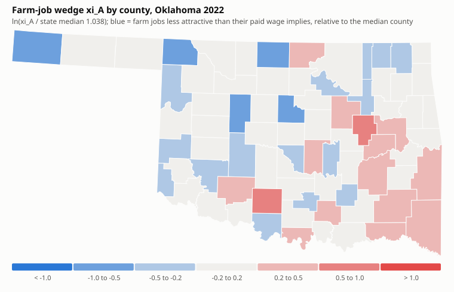

# Oklahoma 2022 calibration report (milestone M3, farm wage revised in M3b)

Tables only: the interpretive paragraphs of the Iowa report (`reports/IA_2022_CALIBRATION.md`) were written for Iowa's numbers and are not repeated here. Read Oklahoma's numbers on their own.

Generated by `python -m urqse.calibrate.run_state OK 2022` from `data/OK/2022/` (M2 build, `reports/OK_2022_REPORT.md`) and LODES8 OD 2022. 77 counties plus the external zone. Wage unit: state mean non-farm earnings per non-farm worker (ACS head) = 89,801 $. w_A,obs is farm labour earnings per farm worker (M2 report, `wA_obs_usd`).

## Estimates

| Parameter | Estimate | Default | Note |
|---|---|---|---|
| kappa*lam (per minute) | **0.0229** (cluster-origin SE 0.0006; robust 0.0004; plain Poisson 0.00003) | 0.08 | PPML, in-state county pairs, own-county flows excluded |
| kappa*lam with own-county flows | 0.0357 (cluster SE 0.0008) | | own time is the M2 area proxy |
| theta_T, state | **0.093** | 0.40 | rent bill / (rent bill + farm labour bill w_A,obs H_A) |
| theta_T, county median (IQR) | 0.027 (0.010 to 0.132) | | same definition |
| over-ID corr(model rho, NASS rent) | -0.040 (logs -0.396) | | 77 published counties |
| over-ID level ratio model/NASS | 6.528 at theta_T = 0.40; 1.000 at 0.093 | | farmland-weighted |

The Oklahoma parameter set is `urqse.calibrate.run_state.state_params('OK', 2022)`: `Params()` with kappa_lam and theta_T replaced by the values in `src/urqse/calibrate/estimates/OK_2022.json`. The global defaults in `params.py`, and so the web app's synthetic scenario, are unchanged.

## 0. Farm wage: M3 comparison

Not computed: BEA farm earnings per farm job are not positive in every county (50 counties at or below 0), so the M3 definition of w_A,obs has no logarithm.

## 1. Inversion fit (spec §5)

| Parameter set | wage contraction | baseline solve | max rel. error HU / HA / wA / N |
|---|---|---|---|
| default `Params()` | converged=True, 74 it, residual 8.0e-14 | converged=True, residual 2.3e-13 | 5.7e-13 / 5.7e-13 / 2.2e-16 / 8.9e-16 |
| Oklahoma estimates | converged=True, 16 it, residual 3.3e-14 | converged=True, residual 8.1e-14 | 2.4e-13 / 2.4e-13 / 2.2e-16 / 8.9e-16 |

Largest relative error of the calibrated fundamentals against jobs, farm wages and residents: 2.4e-13 (bar 1e-7). Flow offsets: converged=True, residual 5.5e-12.

## 2. Farm-job wedge xi_A

xi_A = (effective farm wage) / (observed farm labour earnings per worker), both in units of mean non-farm earnings per worker (spec §5 step 2). Its level is pinned by the normalisation that the job-weighted mean non-farm wage equals 1, so read it relative to the non-farm wedge of 1.

| Group | counties | median xi_A | min | max |
|---|---|---|---|---|
| core | 1 | 1.038 | 1.038 | 1.038 |
| suburb | 17 | 1.040 | 0.605 | 1.934 |
| rural | 59 | 1.032 | 0.451 | 1.953 |
| all with a farm sector | 77 | 1.038 | 0.451 | 1.953 |

## 3. Cash-rent over-identification test (spec §5 step 5)

Model rent rho_j = (theta_T/theta_H) w_Aj H_Aj / T^F_j is in wage units per hectare. In dollars per acre: rho x 89,801 $ x 0.40469 ha/acre. NASS: 2022 county cash rent, non-irrigated cropland (irrigated in a state that publishes no non-irrigated rent; the county data report says which). T^F: CDL cropland. The 0 counties whose rent NASS did not publish (filled in M2 with the 'other counties' value) are left out of the statistics.

| | theta_T = 0.40 | theta_T estimated |
|---|---|---|
| correlation (levels) | -0.040 | -0.040 |
| correlation (logs) | -0.396 | -0.396 |
| OLS slope NASS on model | -0.000 | -0.000 |
| OLS intercept, $/acre | 26.7 | 26.7 |
| log-log slope | -0.090 | -0.090 |
| level ratio model/NASS (farmland-weighted) | 6.528 | 1.000 |
| median county ratio model/NASS | 23.929 | 3.666 |
| s.d. of ln(model/NASS) | 1.753 | 1.753 |

NASS rents span 9 to 52 $/acre; model rents at theta_T = 0.40 span 46 to 40404 $/acre. Correlation and log slope do not depend on theta_T (it scales every county's rent by the same factor).

| County | kind | NASS $/acre | model $/acre (0.40) | model/NASS | farm wage $/worker | farm jobs per 100 ha T^F |
|---|---|---|---|---|---|---|
| Cherokee | rural | 31 | 40404 | 1303.34 | 42,968 | 348.54 |
| Adair | rural | 26 | 23306 | 896.37 | 52,687 | 163.96 |
| Alfalfa | rural | 48 | 52 | 1.10 | 56,069 | 0.35 |
| Kay | rural | 48 | 54 | 1.14 | 33,273 | 0.61 |
| Pushmataha | rural | 28 | 12828 | 466.48 | 32,353 | 146.97 |
| Grant | rural | 41 | 53 | 1.28 | 77,337 | 0.25 |
| Tillman | rural | 33 | 46 | 1.40 | 50,702 | 0.34 |
| Garfield | suburb | 44 | 65 | 1.46 | 48,887 | 0.49 |
## 4. theta_T from rent shares

From (F), rho T^F = (theta_T/theta_H) x (farm labour bill), so theta_T = rent bill / (rent bill + labour bill). Rent bill = NASS cash rent x CDL cropland. Labour bill = w_A,obs x H_A, which is now farm labour earnings in dollars, so the spec §5 literal definition is the chosen one and the M3 netting of owner land rent out of BEA earnings is no longer needed. The rows below it are sensitivities and the M3 definitions.

| Labour bill | state theta_T | county median | p10 | p90 | min | max |
|---|---|---|---|---|---|---|
| farm labour bill wA_obs x HA (chosen; spec §5 literal) | 0.093 | 0.027 | 0.004 | 0.256 | 0.001 | 0.377 |
| same, single-year compensation per farm wage job | 0.126 | 0.038 | 0.005 | 0.328 | 0.001 | 0.462 |
| CoA hired labour expense per farm wage job, all farm jobs | 0.087 | 0.023 | 0.004 | 0.256 | 0.001 | 0.401 |
| M3: BEA farm earnings as labour | 0.328 | -0.007 | -0.245 | 1.106 | -14.987 | 193.472 |
| M3: BEA farm earnings net of owner-operators' land rent (M3 choice) | 0.397 | -0.012 | -0.548 | 0.843 | -10.514 | 5.818 |
| M3: same, 5-year mean farm earnings | 0.249 | 0.007 | -0.187 | 0.737 | -3.911 | 2.160 |
## 5. kappa*lam by PPML on LODES

LODES8 OD 2022, JT00 (all jobs), S000, block pairs summed to residence-county x workplace-county. Files: `ok_od_main`, `ok_od_aux` (out-of-state residents working in OK) and the aux files of AR, CO, KS, MO, NM, TX (OK residents working there). Out-of-state blocks count only if they lie in the 46 counties of the M2 external zone, whose travel time is the time to the nearest of them; other out-of-state blocks are dropped. Total flows used: 1,590,551; in-state 1,532,837, own-county share 0.548; external zone row 24,914, column 39,933. Travel time: `travel.npz` (OSRM car minutes, own-county = M2 area proxy).

ln E[flow_ij] = FE_i + FE_j - kappa*lam t_ij, by Poisson pseudo-ML (Newton, numpy; `urqse.calibrate.gravity`). SEs: plain = inverse Poisson information (assumes Var = mean; far too small under overdispersion), robust = Eicker-White HC0, cluster = sandwich clustered by origin county.

| Sample | kappa*lam | SE cluster | SE robust | SE plain | pairs | zeros | pseudo-R2 | converged (residual) |
|---|---|---|---|---|---|---|---|---|
| in-state, off-diagonal (headline) | 0.0229 | 0.0006 | 0.0004 | 0.00003 | 5852 | 898 | 0.984 | True (1e-10) |
| in-state, own-county flows included | 0.0357 | 0.0008 | 0.0011 | 0.00003 | 5929 | 898 | 0.979 | True (2e-15) |
| in-state, off-diagonal, t <= 90 min | 0.0457 | 0.0017 | 0.0012 | 0.00014 | 590 | 0 | 0.997 | True (7e-11) |
| in-state, off-diagonal, t <= 60 min | 0.0557 | 0.0023 | 0.0020 | 0.00032 | 241 | 0 | 0.999 | True (5e-13) |
| with external zone, off-diagonal | 0.0232 | 0.0007 | 0.0004 | 0.00003 | 6006 | 898 | 0.981 | True (5e-11) |
| with external zone, own-county included | 0.0356 | 0.0008 | 0.0011 | 0.00003 | 6083 | 898 | 0.979 | True (2e-15) |

Restricted to pairs within 90 minutes kappa*lam is 0.0457, within 60 minutes 0.0557.

## 6. Saved outputs

- `data/OK/2022/calibrated.npz` (git-ignored): fips, every `Fundamentals` field, the baseline N, wU, wA, r, rho, the Params used (JSON), and $ per wage unit. Calibrated with the Oklahoma estimates.
- `src/urqse/calibrate/estimates/OK_2022.json` (tracked): kappa_lam and theta_T with sources.
- `tests/snapshots/OK_2022.json` (tracked): pinned summary numbers; `tests/test_snapshot_iowa.py` skips when the data are absent.
- `reports/OK_2022_xi_A.svg`: the xi_A map.

## County table

Model rent at theta_T = 0.40. theta_T by county under the chosen definition. `*` = NASS rent filled in M2.

| FIPS | Name | Kind | xi_A | xi_A (M3) | NASS rent $/ac | model rent $/ac | model/NASS | theta_T | farm wage $/worker | BEA farm earnings $/job | N |
|---|---|---|---|---|---|---|---|---|---|---|---|
| 40001 | Adair | rural | 0.943 | nan | 26 | 23306 | 896.37 | 0.001 | 52,687 | 44,521 | 7,067 |
| 40003 | Alfalfa | rural | 0.872 | nan | 48 | 52 | 1.10 | 0.377 | 56,069 | 10,340 | 2,078 |
| 40005 | Atoka | rural | 1.220 | nan | 18 | 1741 | 96.70 | 0.007 | 39,298 | -17,736 | 4,937 |
| 40007 | Beaver | rural | 1.204 | nan | 15 | 73 | 4.89 | 0.120 | 49,109 | 85,841 | 2,309 |
| 40009 | Beckham | rural | 0.769 | nan | 21 | 206 | 9.79 | 0.064 | 64,088 | -16,774 | 8,281 |
| 40011 | Blaine | rural | 0.610 | nan | 36 | 91 | 2.48 | 0.212 | 73,837 | -16,408 | 3,028 |
| 40013 | Bryan | rural | 1.172 | nan | 15 | 682 | 45.47 | 0.014 | 44,317 | -12,190 | 19,983 |
| 40015 | Caddo | rural | 0.738 | nan | 36 | 178 | 5.02 | 0.117 | 71,300 | -5,798 | 10,624 |
| 40017 | Canadian | suburb | 1.184 | nan | 37 | 106 | 2.87 | 0.188 | 37,188 | -1,491 | 78,324 |
| 40019 | Carter | rural | 1.132 | nan | 16 | 1312 | 79.51 | 0.008 | 43,420 | -18,291 | 21,047 |
| 40021 | Cherokee | rural | 1.220 | nan | 31 | 40404 | 1303.34 | 0.001 | 42,968 | 9,356 | 20,118 |
| 40023 | Choctaw | rural | 1.294 | nan | 28 | 1335 | 47.67 | 0.014 | 38,504 | -18,817 | 5,454 |
| 40025 | Cimarron | rural | 0.451 | nan | 26 | 74 | 2.78 | 0.194 | 120,953 | 94,340 | 1,082 |
| 40027 | Cleveland | suburb | 0.733 | nan | 23 | 1440 | 62.62 | 0.011 | 56,769 | -19,874 | 147,489 |
| 40029 | Coal | rural | 0.838 | nan | 18 | 1380 | 78.86 | 0.008 | 53,186 | 11,631 | 1,959 |
| 40031 | Comanche | suburb | 1.454 | nan | 30 | 185 | 6.17 | 0.097 | 32,785 | -3,290 | 53,915 |
| 40033 | Cotton | suburb | 1.054 | nan | 34 | 51 | 1.47 | 0.312 | 42,477 | -12,672 | 2,353 |
| 40035 | Craig | rural | 0.817 | nan | 32 | 1189 | 37.15 | 0.018 | 58,528 | 10,601 | 5,246 |
| 40037 | Creek | suburb | 1.337 | nan | 14 | 4251 | 293.18 | 0.002 | 33,519 | -18,771 | 30,846 |
| 40039 | Custer | rural | 0.871 | nan | 42 | 113 | 2.69 | 0.199 | 56,155 | -1,894 | 14,054 |
| 40041 | Delaware | rural | 1.213 | nan | 40 | 2355 | 59.63 | 0.011 | 41,614 | 82,615 | 15,849 |
| 40043 | Dewey | rural | 1.032 | nan | 32 | 82 | 2.58 | 0.205 | 47,694 | -16,838 | 1,836 |
| 40045 | Ellis | rural | 0.667 | nan | 18 | 198 | 10.68 | 0.059 | 74,385 | 52,041 | 1,559 |
| 40047 | Garfield | suburb | 0.992 | nan | 44 | 65 | 1.46 | 0.313 | 48,887 | -1,656 | 28,409 |
| 40049 | Garvin | rural | 1.072 | nan | 20 | 532 | 27.27 | 0.024 | 44,247 | -14,261 | 10,699 |
| 40051 | Grady | suburb | 1.238 | nan | 44 | 237 | 5.39 | 0.110 | 38,454 | 2,325 | 24,743 |
| 40053 | Grant | rural | 0.605 | nan | 41 | 53 | 1.28 | 0.342 | 77,337 | 2,557 | 1,798 |
| 40055 | Greer | rural | 0.909 | nan | 22 | 94 | 4.39 | 0.132 | 52,074 | 17,030 | 1,926 |
| 40057 | Harmon | rural | 0.798 | nan | 22 | 79 | 3.58 | 0.157 | 57,862 | 31,762 | 1,069 |
| 40059 | Harper | rural | 0.586 | nan | 15 | 126 | 8.40 | 0.074 | 87,338 | 99,046 | 1,403 |
| 40061 | Haskell | rural | 0.898 | nan | 24 | 4310 | 183.41 | 0.004 | 51,044 | 51,705 | 4,404 |
| 40063 | Hughes | rural | 1.127 | nan | 16 | 1515 | 97.75 | 0.007 | 41,934 | 137,886 | 4,260 |
| 40065 | Jackson | rural | 1.266 | nan | 32 | 58 | 1.82 | 0.268 | 39,237 | -1,136 | 11,658 |
| 40067 | Jefferson | rural | 0.700 | nan | 27 | 132 | 4.89 | 0.120 | 64,899 | 10,064 | 2,048 |
| 40069 | Johnston | rural | 1.670 | nan | 14 | 720 | 53.32 | 0.012 | 27,728 | -11,993 | 3,736 |
| 40071 | Kay | rural | 1.476 | nan | 48 | 54 | 1.14 | 0.368 | 33,273 | -4,846 | 18,612 |
| 40073 | Kingfisher | rural | 0.883 | nan | 36 | 78 | 2.17 | 0.235 | 52,441 | 11,839 | 6,850 |
| 40075 | Kiowa | rural | 0.721 | nan | 33 | 67 | 2.02 | 0.248 | 66,721 | 32,178 | 3,253 |
| 40077 | Latimer | rural | 1.217 | nan | 16 | 6238 | 378.06 | 0.002 | 39,569 | -1,985 | 3,509 |
| 40079 | Le Flore | rural | 1.338 | nan | 19 | 1350 | 71.08 | 0.009 | 40,809 | 60,376 | 18,627 |
| 40081 | Lincoln | suburb | 1.134 | nan | 26 | 1470 | 55.49 | 0.012 | 41,167 | -21,494 | 14,320 |
| 40083 | Logan | suburb | 0.605 | nan | 30 | 330 | 11.18 | 0.056 | 70,823 | -16,077 | 22,183 |
| 40085 | Love | rural | 1.458 | nan | 21 | 503 | 23.93 | 0.027 | 31,931 | -19,346 | 4,203 |
| 40087 | McClain | suburb | 0.853 | nan | 52 | 489 | 9.41 | 0.066 | 51,093 | -9,776 | 20,149 |
| 40089 | McCurtain | rural | 1.654 | nan | 20 | 1067 | 52.05 | 0.013 | 35,687 | 40,793 | 12,201 |
| 40091 | McIntosh | rural | 1.451 | nan | 21 | 1366 | 65.03 | 0.010 | 30,714 | -11,266 | 6,183 |
| 40093 | Major | rural | 0.994 | nan | 30 | 85 | 2.82 | 0.191 | 50,006 | 5,778 | 3,387 |
| 40095 | Marshall | rural | 1.145 | nan | 16 | 1060 | 64.27 | 0.010 | 38,523 | -19,584 | 5,890 |
| 40097 | Mayes | rural | 0.961 | nan | 33 | 1687 | 51.11 | 0.013 | 50,374 | 4,387 | 16,439 |
| 40099 | Murray | rural | 0.647 | nan | 32 | 2119 | 66.21 | 0.010 | 64,403 | -9,361 | 5,893 |
| 40101 | Muskogee | rural | 1.287 | nan | 28 | 747 | 27.18 | 0.024 | 36,684 | -11,356 | 25,734 |
| 40103 | Noble | rural | 0.855 | nan | 34 | 113 | 3.34 | 0.167 | 50,843 | -4,074 | 4,712 |
| 40105 | Nowata | rural | 0.816 | nan | 20 | 1195 | 59.73 | 0.011 | 54,280 | -11,943 | 3,905 |
| 40107 | Okfuskee | rural | 1.224 | nan | 22 | 1290 | 58.64 | 0.011 | 34,898 | -18,785 | 3,780 |
| 40109 | Oklahoma | core | 1.038 | nan | 36 | 824 | 22.56 | 0.029 | 40,389 | -9,893 | 381,419 |
| 40111 | Okmulgee | suburb | 1.934 | nan | 18 | 797 | 45.53 | 0.014 | 24,252 | -10,063 | 14,677 |
| 40113 | Osage | suburb | 1.005 | nan | 20 | 705 | 35.25 | 0.019 | 48,506 | 5,743 | 18,825 |
| 40115 | Ottawa | rural | 0.928 | nan | 41 | 600 | 14.64 | 0.044 | 53,285 | 37,912 | 12,105 |
| 40117 | Pawnee | suburb | 0.795 | nan | 23 | 541 | 23.52 | 0.028 | 52,773 | -21,953 | 6,520 |
| 40119 | Payne | rural | 1.255 | nan | 24 | 652 | 27.17 | 0.024 | 37,725 | -14,548 | 36,655 |
| 40121 | Pittsburg | rural | 1.693 | nan | 14 | 2694 | 199.54 | 0.003 | 30,431 | -12,046 | 16,848 |
| 40123 | Pontotoc | rural | 1.240 | nan | 17 | 3894 | 229.05 | 0.003 | 38,865 | -10,751 | 17,006 |
| 40125 | Pottawatomie | rural | 1.505 | nan | 24 | 964 | 40.17 | 0.016 | 30,746 | -15,586 | 29,303 |
| 40127 | Pushmataha | rural | 1.518 | nan | 28 | 12828 | 466.48 | 0.001 | 32,353 | -14,846 | 3,588 |
| 40129 | Roger Mills | rural | 0.858 | nan | 30 | 154 | 5.06 | 0.116 | 56,869 | -11,492 | 1,469 |
| 40131 | Rogers | suburb | 1.040 | nan | 26 | 1814 | 69.76 | 0.009 | 44,170 | -14,585 | 45,762 |
| 40133 | Seminole | rural | 0.786 | nan | 18 | 4767 | 264.84 | 0.003 | 57,837 | -9,347 | 8,453 |
| 40135 | Sequoyah | suburb | 1.131 | nan | 16 | 1265 | 79.06 | 0.008 | 42,922 | -3,109 | 15,212 |
| 40137 | Stephens | rural | 1.953 | nan | 16 | 289 | 17.53 | 0.037 | 25,235 | -15,416 | 17,283 |
| 40139 | Texas | rural | 1.032 | nan | 20 | 98 | 4.92 | 0.119 | 59,499 | 186,182 | 10,085 |
| 40141 | Tillman | rural | 0.959 | nan | 33 | 46 | 1.40 | 0.322 | 50,702 | -34,311 | 2,709 |
| 40143 | Tulsa | suburb | 0.850 | nan | 24 | 2046 | 83.49 | 0.008 | 49,412 | -275 | 318,243 |
| 40145 | Wagoner | suburb | 1.039 | nan | 26 | 327 | 12.34 | 0.051 | 41,378 | -5,549 | 38,272 |
| 40147 | Washington | rural | 0.814 | nan | 9 | 1233 | 135.52 | 0.005 | 54,251 | -15,198 | 22,900 |
| 40149 | Washita | rural | 0.865 | nan | 37 | 61 | 1.66 | 0.287 | 56,716 | -14,048 | 4,710 |
| 40151 | Woods | rural | 1.259 | nan | 28 | 78 | 2.75 | 0.195 | 43,675 | 9,170 | 4,044 |
| 40153 | Woodward | rural | 1.139 | nan | 23 | 180 | 7.82 | 0.079 | 46,149 | -90,296 | 9,248 |
